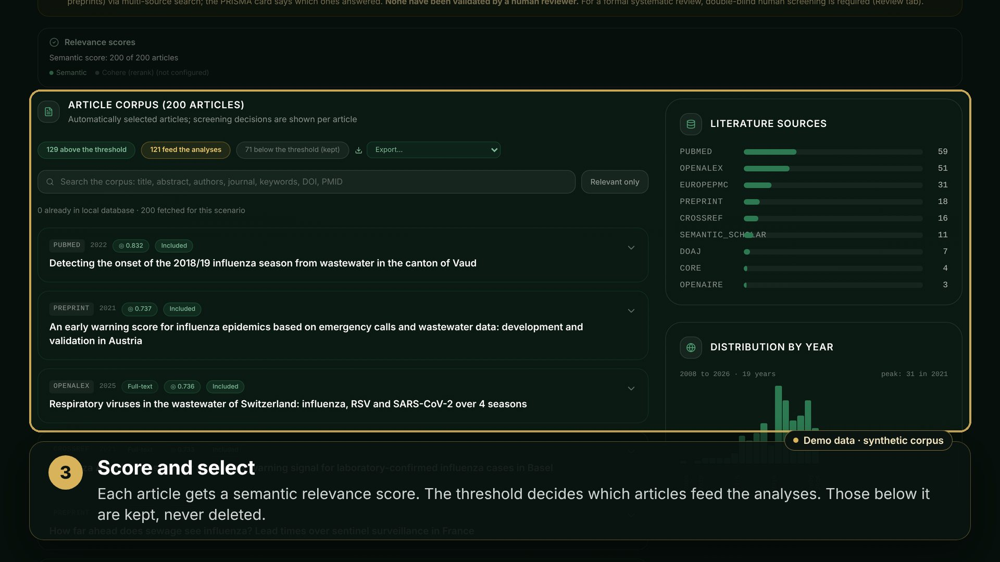

# LiteRev · Evidence to Scenario

LiteRev turns a research question into an evidence-backed scenario: a multi-source
literature search, evidence synthesis (PICO, PRISMA screening, GRADE levels), an AI
assistant grounded in the corpus, clustering and a concept map, through to a predictive
model trained on real data. In production at [literev-scenario.com](https://literev-scenario.com).

## The main pipeline, in a short video

Watch it in [English](docs/demo/literev-demo-en.mp4) or in [French](docs/demo/literev-demo-fr.mp4)
(subtitles: [en](docs/demo/literev-demo-en.vtt), [fr](docs/demo/literev-demo-fr.vtt)).
It is recorded by code from the real interface, on a synthetic demo corpus, so
`python3 scripts/demo_video.py` makes it again whenever the interface changes:
[docs/demo-video.md](docs/demo-video.md) says how, and what in it is real.

## Documentation

- [Architecture](docs/ARCHITECTURE.md): what the app does, how the pieces fit, how it ships.
- [Operations runbook](docs/ops-runbook.md), [infrastructure](docs/INFRASTRUCTURE.md),
  [admin API](docs/ADMIN_API.md).
- [Data sources](docs/DATA_SOURCES.md) and their [limits](docs/SOURCE_LIMITS.md).
- [GESICA user guide](docs/GESICA_User_Guide.md) and [scientific base](docs/GESICA_Scientific_Base.md) (in French).
- [Frontend](frontend/README.md): develop, build and test the interface.
- [CLAUDE.md](CLAUDE.md): the house rules of the repository.
